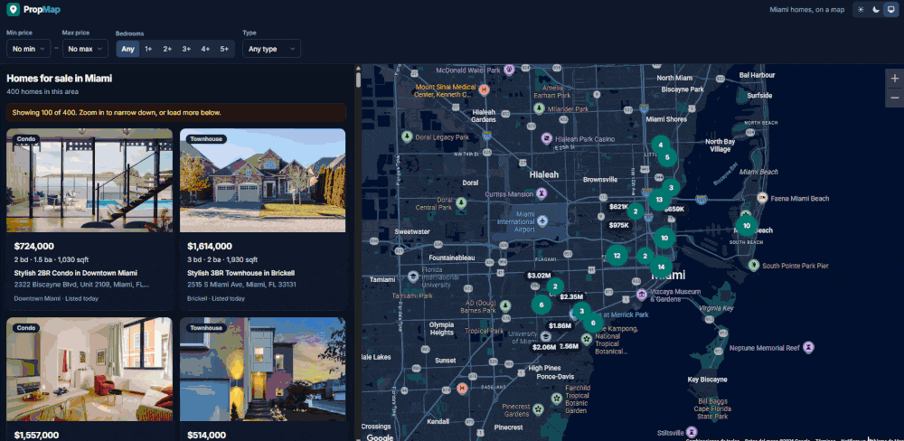
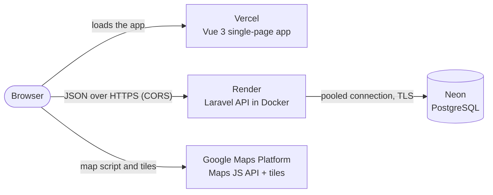

# PropMap

Search Miami homes on a map: pan, zoom and filter, and the list updates to show only the listings in view.

**[Live demo](https://propmap-alpha.vercel.app)** · [API sample](https://propmap-api-97jr.onrender.com/api/properties?per_page=5) · [Backend CI](https://github.com/jrisquezb89/propmap/actions/workflows/backend.yml)

> The API runs on a free tier that sleeps when idle, so the first visit can take up to a minute. The app shows a "Waking up the server…" state instead of a blank page.

<!-- Demo recording: add docs/demo.gif -->


## Features

- **Map search.** Results follow the map: when you stop panning or zooming, the app fetches the listings inside the visible area.
- **Clustered price pins.** Google Maps Advanced Markers show each price. Nearby markers group into clusters when zoomed out.
- **Filters that live in the URL.** Price range, minimum bedrooms and property type are part of the URL, along with the map position. A search can be shared, bookmarked, and survives a reload; the browser's Back button undoes the last filter change.
- **List and map in sync.** Hovering a card highlights its pin. Clicking a pin scrolls to its card.
- **Property detail page** with photos, facts and a small map.
- **Cold-start handling.** If the server is asleep, the app shows a friendly waiting message and placeholder cards, and keeps retrying. Errors and empty results each have their own clear message.
- **Responsive.** List and map sit side by side on desktop. On mobile there's a List/Map toggle, and tapping a pin shows a compact preview.
- **Light and dark themes**, including Google's dark map style. The app follows the system setting by default.
- **Accessible.** Keyboard-focusable markers, screen-reader announcements of result counts, focus management between pages, and support for reduced motion.

## Tech stack

| Layer | Technology |
|---|---|
| Frontend | Vue 3, TypeScript, Vite, Pinia, Vue Router, Tailwind CSS v4 |
| Maps | Google Maps JavaScript API with Advanced Markers and a Map ID, `@googlemaps/markerclusterer` |
| Backend | Laravel 13 (PHP 8.5), API only, with API Resources and Form Request validation |
| Database | PostgreSQL on Neon (serverless) |
| Hosting | Vercel (frontend), Render free tier with Docker and FrankenPHP (API) |
| Testing & CI | PHPUnit feature tests against real Postgres, Vitest unit tests, GitHub Actions, Laravel Pint |

## Architecture



- **Vercel only serves static files.** The browser calls the API on Render directly. The API only answers CORS requests from origins listed in an environment variable.
- **The API is a single Docker container.** It runs migrations and seeds the demo data on boot. It's in the same AWS region as the Neon database (US East, Ohio) to keep query latency low.
- **Google Maps loads in the browser.** The API never talks to Google.

## Technical decisions

**1. Map search on indexed `lat`/`lng` columns instead of PostGIS.**
A map viewport is a rectangle, so the query is two range conditions on latitude and longitude. A composite B-tree index on `(lat, lng)` handles that well at this scale, and there are also indexes on `price` and `listed_at` (the default sort). It needs no database extension and is easy to test. If I needed radius search, polygons or millions of rows, I'd move to a PostGIS `geography` column with a GiST index (Neon supports it).
→ [migration](backend/database/migrations/2026_11_03_000000_create_properties_table.php) · [query scopes](backend/app/Models/Property.php)

**2. Debounced, cancellable map fetching.**
- The app fetches only after the map's `idle` event (the camera stopped moving), debounced by 300 ms.
- Bounds are rounded, so tiny camera jitter doesn't trigger a request.
- Each new search cancels the previous request with an `AbortController`, so a slow response for an old view can never overwrite the current results. A unit test covers this.

→ [PropertyMap.vue](frontend/src/components/map/PropertyMap.vue) · [search store](frontend/src/stores/search.ts)

**3. The URL is the single source of truth for filters.**
Filter controls write to the URL, and everything else reads from it, so data only flows one way. Sharing and reloading need no extra code.
- Filter changes add a browser-history entry, so Back undoes them.
- Map moves replace the current entry instead, so panning doesn't fill the history.
- Parsing is a pure function, and invalid values such as `?bedrooms=abc` are dropped instead of breaking the page.

→ [lib/filters.ts](frontend/src/lib/filters.ts) · [useUrlFilters.ts](frontend/src/composables/useUrlFilters.ts)

**4. A cold-start strategy instead of a blank screen.**
The free tier sleeps after 15 minutes idle. On load, the app calls a health endpoint that deliberately skips the database:
- If it answers within 2 seconds, the user sees nothing special.
- Otherwise a "Waking up the server…" banner and placeholder cards appear. The app keeps retrying with increasing delays and gives up after 90 seconds with a Retry button.
- On the server side, migrations and seeding run on every boot but are safe to repeat, because the free tier has no pre-deploy step.

The client-side state machine is unit-tested with fake timers.
→ [server store](frontend/src/stores/server.ts) · [entrypoint](backend/docker/entrypoint.sh)

**5. Cost controls on Google Maps.**
A Maps key used in the browser is public by design, so it can't be hidden; it has to be restricted instead. Mine is restricted by HTTP referrer (the live domain and localhost) and to the Maps JavaScript API only, with a budget alert. The code also avoids paying for unnecessary map loads:
- The Maps script loads once per visit.
- The mobile List/Map toggle hides the map rather than destroying it. That also keeps its size, so the map area it reports stays correct.
- Switching themes is the only action that rebuilds the map, because Google only accepts the color scheme when a map is created.

→ [useGoogleMaps.ts](frontend/src/composables/useGoogleMaps.ts) · [SearchView.vue](frontend/src/views/SearchView.vue)

**6. Google's map objects stay outside Vue's reactivity.**
The map, the markers and the clusterer are stored in plain variables. Wrapping them in Vue's reactive proxies would slow them down and can break Google's internal checks. Markers are kept in a lookup table by property ID, and new results are compared against it so only changed markers are added or removed. Highlighting a pin toggles a CSS class on that one element, so hovering a card never re-renders the map.
→ [PropertyMap.vue](frontend/src/components/map/PropertyMap.vue)

<details>
<summary>More details</summary>

- **Realistic seed data.** Each Miami neighborhood is a hand-drawn polygon, and listings are only placed at points inside it, so none land in Biscayne Bay. Prices are derived from each neighborhood's price per square foot. The random seed is fixed, so every environment gets the same 400 listings. → [MiamiNeighborhoods.php](backend/app/Support/MiamiNeighborhoods.php)
- **Data types.** Money is stored as integer dollars, never floats. Property type is a string column with a database constraint, mapped to a PHP enum.
- **Production container.** FrankenPHP (PHP and the Caddy web server in one binary) runs as a single process, which suits Render's one-container free tier. It runs as a non-root user. → [Dockerfile](backend/Dockerfile)
- **Tests run against Postgres, not SQLite**, both locally and in CI, so they exercise the same database engine as production.
- **Dark theme.** Colors are defined as semantic tokens (`bg-surface`, `text-fg`), so the dark theme is one block of CSS. A small script applies the saved theme before the first paint, so there's no white flash.

</details>

## How I used AI

I built PropMap with [Claude Code](https://claude.com/claude-code), Anthropic's AI coding agent.

- **What I decided:** the product and its features, the stack (Vue 3 and Laravel), and the architecture and hosting (Neon, Render, Vercel, Google Maps).
- **How each phase went:** I asked for a plan before any code was written, reviewed it, and made the calls. Examples: keeping the map position in the URL; showing up to 100 results with "Load more" instead of adding a separate endpoint for map markers; the database region; keeping the repo private until launch; adding a dark theme partway through.
- **Who wrote the code:** Claude Code wrote most of the code, the tests and the deployment config, working from those plans. I reviewed the work, steered it, and asked for changes when something didn't fit.
- **How it was verified:** automated tests run in CI, and every main flow was checked in a real browser, both locally and on the live site.
- **What surfaced at deploy:** several issues appeared only when deploying. FrankenPHP failed to start on Render, the database connection picked up the wrong port, and pagination links came back as `http://` behind Render's proxy. Each was reproduced, fixed, and covered by a test or a local check before redeploying.

## Running locally

**Requirements:** PHP 8.3+ with the `pdo_pgsql` extension, Composer, Docker, and Node.js 20.19+.

### Backend

```bash
cd backend
composer install
cp .env.example .env
php artisan key:generate
docker compose up -d          # local Postgres on port 5433, plus a propmap_test database
php artisan migrate --seed    # creates the schema and 400 Miami listings
php artisan serve             # http://localhost:8000
```

### Frontend

```bash
cd frontend
npm install
cp .env.example .env          # then fill in the values below
npm run dev                   # http://localhost:5173
```

Without a Google Maps key, the app still works: the list shows all of Miami and the map area shows a "Map unavailable" message.

### Environment variables

Real values go in `.env` files, which are gitignored, or in your hosting dashboard. Never commit them.

**Backend** (`backend/.env`)

| Variable | Purpose |
|---|---|
| `APP_KEY` | Laravel encryption key. Generate one with `php artisan key:generate --show` |
| `DB_HOST`, `DB_PORT`, `DB_DATABASE`, `DB_USERNAME`, `DB_PASSWORD` | Local Postgres from `compose.yaml` (defaults in `.env.example`) |
| `DB_URL` | Production connection string (Neon, pooled, with `sslmode=require`). When set, it takes priority over the `DB_*` values above |
| `FRONTEND_URLS` | Comma-separated origins allowed by CORS, e.g. `http://localhost:5173,https://your-app.vercel.app` |
| `FRONTEND_URL_PATTERN` | Optional regular expression for extra allowed origins, e.g. Vercel preview URLs |

**Frontend** (`frontend/.env`)

| Variable | Purpose |
|---|---|
| `VITE_API_URL` | API base URL, e.g. `http://localhost:8000/api` |
| `VITE_GOOGLE_MAPS_API_KEY` | Browser key for the Maps JavaScript API. Restrict it by HTTP referrer |
| `VITE_GOOGLE_MAPS_MAP_ID` | Map ID (JavaScript, vector type), required for Advanced Markers |

### Tests

```bash
# Backend: feature tests against Postgres (start it first with docker compose up -d)
cd backend
php artisan test
vendor/bin/pint --test        # code style

# Frontend: unit tests, type-check and production build
cd frontend
npm test
npm run typecheck
npm run build
```

Backend tests and the code-style check run in GitHub Actions on every push.

## API reference

| Endpoint | Description |
|---|---|
| `GET /api/properties` | Paginated listings, newest first. Filters: `min_price`, `max_price`, `bedrooms` (minimum), `type` (`house`, `condo`, `townhouse`), and a map area as `north`, `south`, `east`, `west` (all four or none). `per_page` goes up to 100 |
| `GET /api/properties/{id}` | One property, or `404` |
| `GET /api/health` | Quick health check that skips the database. The frontend calls it to wake the server |

Invalid input returns `422` with an error message for each field. Example:

```bash
curl "https://propmap-api-97jr.onrender.com/api/properties?type=condo&max_price=1000000&north=25.77&south=25.75&east=-80.19&west=-80.205"
```

## Deployment

- **API:** [`render.yaml`](render.yaml) defines the Render service. Secrets (`APP_KEY`, `DB_URL`, `FRONTEND_URLS`) are set in the Render dashboard.
- **Frontend:** Vercel builds the `frontend/` folder. [`vercel.json`](frontend/vercel.json) sends every path to the app, so direct links like `/properties/22` work.
- **Database:** Neon, in the same region as the API.

## Project structure

```
propmap/
├── backend/            Laravel API: models, Form Requests, API Resources, seeders, feature tests, Dockerfile
├── frontend/           Vue app: views, components, Pinia stores, composables, unit tests
├── render.yaml         Render configuration for the API
└── .github/workflows/  CI for the backend
```

## Known limitations

- A request returns at most 100 properties. The app says so and offers "Load more". A much larger dataset would call for clustering on the server.
- Map areas that cross the international date line aren't supported, which can't happen for Miami.
- Listings and photos are generated demo data, not real properties for sale.
